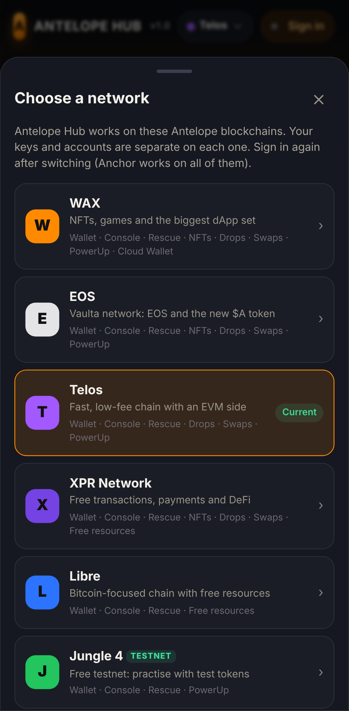
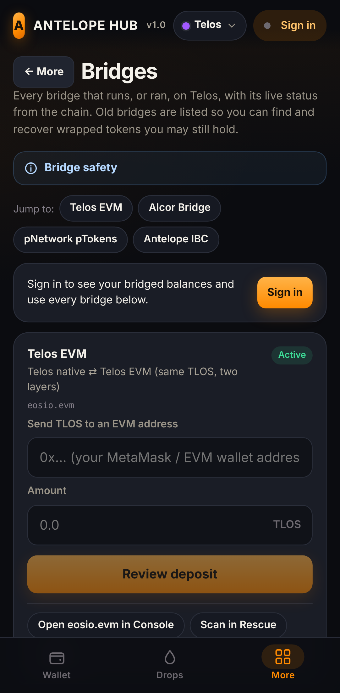
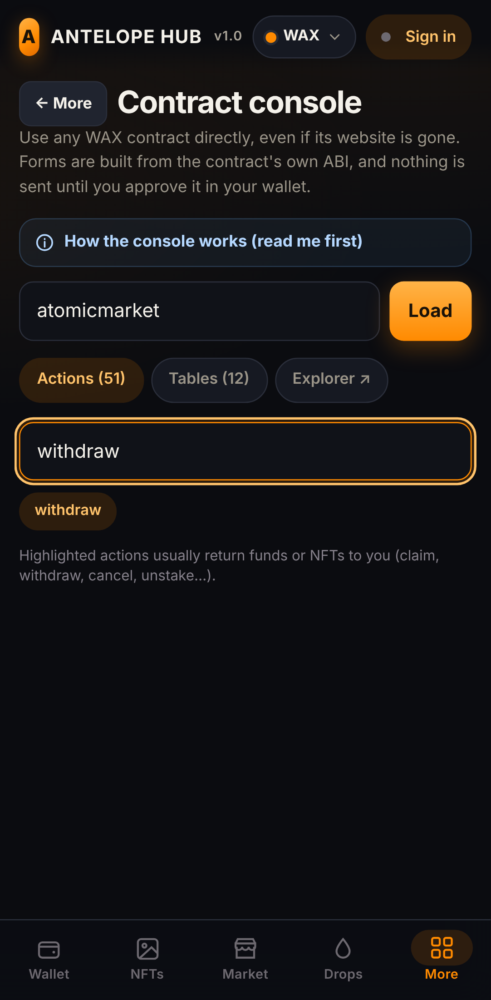
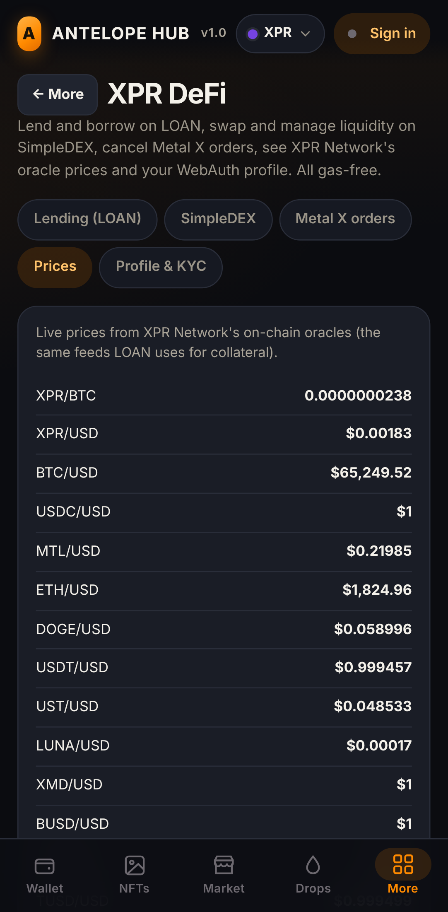

<p align="center">
  
</p>

<h1 align="center">Antelope Hub</h1>

<p align="center">
  <b>A free wallet and toolkit for the Antelope blockchains.</b><br>
  WAX · EOS (Vaulta) · Telos · XPR Network · Libre · Jungle 4 testnet<br>
  Android and Linux · open source · no accounts, no tracking
</p>

<p align="center">
  <a href="../../releases/latest"><b>⬇ Download the latest release</b></a> ·
  <a href="docs/USER_GUIDE.md"><b>User guide</b></a>
</p>

<p align="center">
  
  
  
  
</p>

## What's new in 1.2

- **Sign in with WebAuth** on XPR Network, next to Anchor
- **Trade on Metal X**: limit and market orders on every market
- **PowerUp works**: pick how much CPU and NET, see the live price (100 ms of CPU ≈ 0.02 WAX); Telos rents CPU from REX
- **Recent fixes**: NFT pictures load again, Packs lists your own packs, and EOS accounts that hold only A can still move their NFTs

All changes: [CHANGELOG.md](CHANGELOG.md)

## What it does

- **Wallet**: balances, send and receive, staking, RAM, PowerUp and voting on every network. Sign in with Anchor, My Cloud Wallet (WAX) or WebAuth (XPR Network)
- **NFTs**: view, send, buy and sell, open packs, plus a Creator studio to mint your own
- **Bridges and cross-chain**: move tokens between Antelope chains and Ethereum, BNB Chain, Polygon and more, including WAX → Ethereum and A → EOS EVM
- **EOS (Vaulta)**: convert EOS ⇄ A, and pay for CPU, NET and RAM with A when you run out
- **Telos studio**: polls, community voting tokens, Telos Works funding
- **XPR DeFi**: LOAN lending, SimpleDEX swaps, Metal X trading, oracle prices, WebAuth profiles
- **Rescue & recover**: finds tokens, NFTs, rewards and refunds stuck in contracts (including the Wombat Dungeon), and gets them back
- **Contract console**: use any smart contract directly, even if its website has gone

## Install

| Platform | File | How |
|---|---|---|
| **Android** 6.0+ | `antelope-hub-<version>.apk` | Open it on your phone and allow the install if Android asks |
| **Ubuntu / Debian / Mint** | `antelope-hub-<version>-amd64.deb` | `sudo apt install ./antelope-hub-<version>-amd64.deb` |
| **Any Linux** | `antelope-hub-<version>-x86_64.AppImage` | `chmod +x antelope-hub-*.AppImage && ./antelope-hub-*.AppImage` |

Get the files from the [Releases page](../../releases/latest), and check them against `SHA256SUMS.txt`:

```bash
sha256sum -c SHA256SUMS.txt --ignore-missing
```

## Quick start

1. Open the app and pick your network with the chip at the top.
2. Tap **Sign in** and choose **Anchor** (any network), **My Cloud Wallet** (WAX) or **WebAuth** (XPR Network).
3. No account yet? Go to **More → New account**.
4. Before anything is sent, you see a summary, and your wallet asks you to approve.

## FAQ

**Is it safe? Does it see my keys?**
No. Your keys stay in your wallet, and the app never handles them. You approve every transaction in your wallet, and if you reject it nothing is sent. Only download from this repository's Releases page.

**I used WAX Hub. Do I need to uninstall it?**
No. On Android, Antelope Hub installs over WAX Hub as an update. It's the same app with the same signing key, so your settings carry over.

**Which wallet should I use?**
[Anchor](https://www.greymass.com/anchor) works on every network. On WAX you can also use [My Cloud Wallet](https://www.mycloudwallet.com/). On XPR Network you can also sign in with [WebAuth](https://webauth.com/).

**The AppImage won't start on Ubuntu 24.04.**
Use the `.deb` instead. Newer Ubuntu blocks the sandbox AppImages need. On Ubuntu 22.04 you may need `sudo apt install libfuse2`.

**It says I don't have enough CPU, NET or RAM.**
Rent CPU and NET for a day with **More → Chain tools → PowerUp**, or buy a little RAM in the wallet. On EOS, if you only hold A, the app pays for resources in A automatically (see the Vaulta card). On XPR Network and Libre, resources are free.

**I think I have tokens or NFTs stuck somewhere.**
Run **More → Rescue & recover**. It checks dozens of contracts and builds the transaction to get them back.

**Does it cost anything?**
No. The app is free. You only pay normal network costs (none on XPR Network or Libre) and any fees a bridge or exchange charges, which the app shows before you sign.

**Something isn't working.**
Open an [issue](../../issues/new/choose) and tell us your platform and app version. Never post private keys, seed phrases or passwords.

## More

- [User guide](docs/USER_GUIDE.md): every screen, plus a full walkthrough of the Contract console
- [Building from source](docs/BUILDING.md) · [Security](SECURITY.md) · [Contracts covered](CONTRACTS.md) · [Changelog](CHANGELOG.md)

## Licence

[MIT](LICENSE). Third-party components are listed in [THIRD_PARTY_NOTICES.md](THIRD_PARTY_NOTICES.md). Antelope Hub is an independent community project and isn't affiliated with any of the networks or projects it works with.
