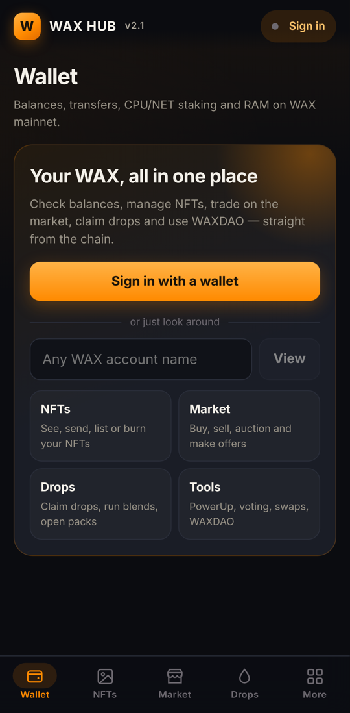
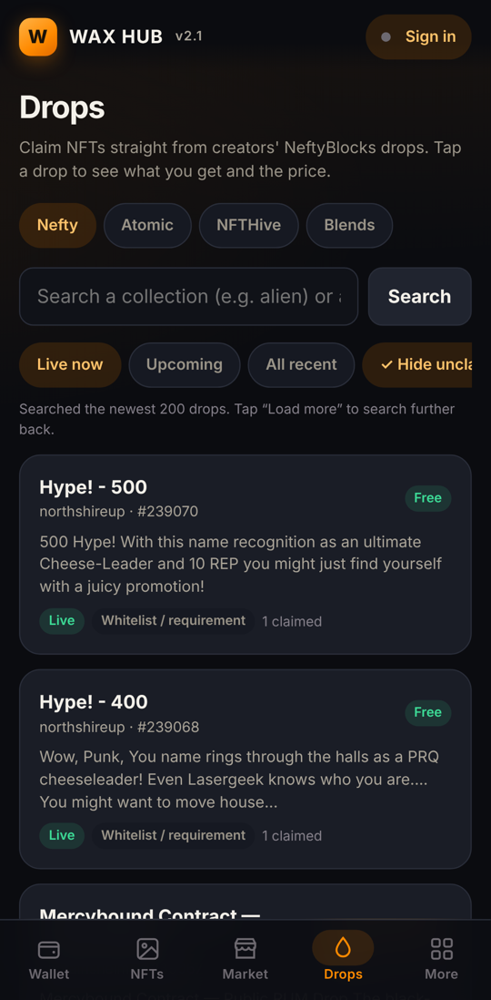
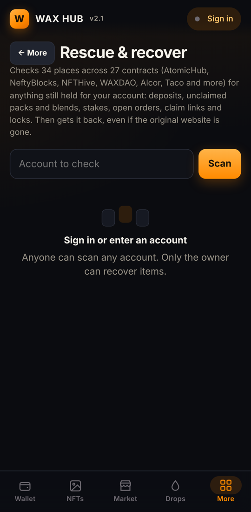
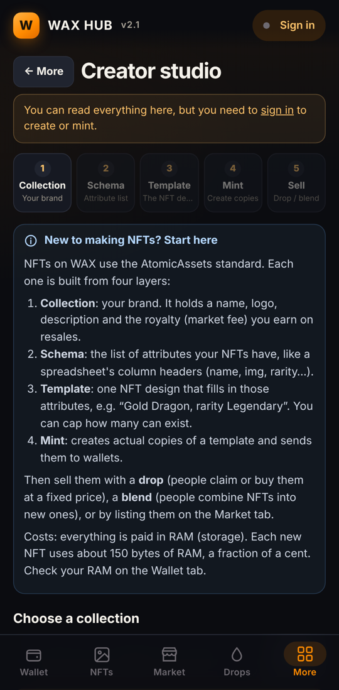

<p align="center">
  
</p>

<h1 align="center">Antelope Hub</h1>

<p align="center">
  <b>One free app for the Antelope blockchains: wallet, bridges, cross-chain swaps, DeFi, NFTs and asset rescue.</b><br>
  WAX · EOS (Vaulta) · Telos · XPR Network · Libre · Jungle 4 testnet. Android and Linux.<br>
  It talks straight to the blockchains, so it keeps working when other websites shut down.
</p>

<p align="center">
  Wallet & staking · Bridges & cross-chain (Alcor) · Telos governance studio · XPR DeFi (LOAN, SimpleDEX, Metal X)<br>
  Rescue stuck assets · NFT creator · Contract console · Guided account creation
</p>

> **Antelope Hub replaces WAX Hub.** The old WAX-only app is retired. On Android, Antelope Hub installs over WAX Hub as an update (same app, same signing key), so your settings carry over.

<p align="center">
  <a href="../../releases/latest"><b>⬇ Download the latest release</b></a>
</p>

---

## Download

| Platform | File | How to install |
|---|---|---|
| **Android** 6.0+ | `antelope-hub-4.4.0.apk` | Open the file on your phone and allow installs from your browser or file manager if Android asks. |
| **Linux** (Ubuntu, Debian, Mint, Pop!_OS) | `antelope-hub-4.4.0-amd64.deb` | `sudo apt install ./antelope-hub-4.4.0-amd64.deb`, then open **Antelope Hub** from your apps menu. |
| **Linux** (any distro) | `antelope-hub-4.4.0-x86_64.AppImage` | `chmod +x antelope-hub-4.4.0-x86_64.AppImage && ./antelope-hub-4.4.0-x86_64.AppImage` |

All files are on the [Releases page](../../releases/latest). Check your download against `SHA256SUMS.txt` on the same page:

```bash
sha256sum -c SHA256SUMS.txt --ignore-missing
```

> **Ubuntu 24.04 and newer:** use the `.deb`. Ubuntu blocks the sandbox that AppImages built with Electron rely on, so the AppImage may not start there.
> **AppImage on older Ubuntu (22.04):** you may need `sudo apt install libfuse2`.

## Networks

Switch network from the chip at the top of the app. Features appear where their contracts exist on that chain:

| Feature | WAX | EOS | Telos | XPR | Libre | Jungle 4 |
|---|:-:|:-:|:-:|:-:|:-:|:-:|
| Wallet, send/receive, history, voting | ✓ | ✓ | ✓ | ✓ | ✓ | ✓ (no history) |
| Rescue & recover, Contract console | ✓ | ✓ | ✓ | ✓ | ✓ | ✓ |
| Staking, PowerUp, account creation | ✓ | ✓ | ✓ | free resources | free resources | ✓ |
| NFTs, Market, Creator studio | ✓ | ✓ | (no public NFT API) | ✓ | – | – |
| Drops / blends | ✓ | AtomicHub drops | blends | drops, blends | – | – |
| Swaps | ✓ | Alcor | Alcor | Alcor | – | – |
| Bridges | WAX Bridge, IBC, Alcor, Wombat | EOS EVM, pTokens, IBC, Alcor | Telos EVM, Alcor hub, pTokens, IBC | XPR wrap, Alcor | BTC bridge, USDT, pTokens | – |
| Vaulta $A (convert EOS ⇄ A) | – | ✓ | – | – | – | ✓ |
| WAXDAO, packs, NeftyBlocks drops | ✓ | – | – | – | – | – |
| Network essentials | voting rewards, genesis | REX, RAM gifting, name auctions | Telos Decide votes, REX staking rewards | XPR staking, Metal X | LIBRE staking, DAO votes | REX, RAM, names (test) |
| Sign-in | Cloud Wallet, Anchor | Anchor | Anchor | Anchor | Anchor | Anchor |

## Bridges

**More → Bridges** lists every bridge that runs, or ran, on the active network. Each shows its live status from the chain (Active, Quiet or Inactive since a date), the wrapped tokens you still hold from it, and the actions that are verified on mainnet:

- **Telos EVM**: send TLOS to any EVM address, and withdraw your linked EVM balance back to Telos.
- **EOS EVM**: send supported tokens (USDT, BOX, SEOS, PINK…) to an EVM address. The entry fee is shown.
- **pNetwork pTokens** (EOS, Telos, Libre): redeem pBTC to Bitcoin or pUSDT to Ethereum, with clear warnings because pNetwork has wound down many routes.
- **WAX Bridge** (Ethereum, BNB Chain, Solana): claim incoming transfers that were never completed, by account or by transaction hash.
- **Alcor Bridge**: on WAX, EOS and XPR, send tokens to Telos or straight on to Ethereum, BNB Chain, Polygon or another Antelope chain; on the Telos hub, claim parked balances and send tokens out on any open route.
- **Libre Bitcoin bridge**: see your BTC deposit address, and peg out to a Bitcoin address.
- **Libre USDT bridge**: withdraw USDT to an Ethereum address.
- **Antelope IBC, Wombat, XPR wrapped assets**: status, your wrapped balances and what you can still do with them.

Rescue & recover also finds unclaimed WAX Bridge transfers, linked Telos EVM balances, Alcor bridge claims and tokens left over from old bridges.

## Cross-chain (Alcor)

**More → Cross-chain** (WAX, EOS, Telos, XPR Network) uses Alcor's bridge API:

- **Receive**: a personal deposit address on Ethereum, BNB Chain and Polygon (plus TON, NEAR, Sui) that pays into your account, even from an exchange. The EVM address is recomputed on the device (CREATE2 from Alcor's factory) and shown only when it matches.
- **Swap across chains**: any token you hold to another token on another chain, in one signature (`/v1/swap/plan`). The app signs only plans whose actions go to `swap.alcor`, `bridge.alcor` or `book.alcor` from your account and name your recipient, and re-plans when you approve.
- **Get paid in…** (beta): a deposit address that swaps every deposit into a chosen token and chain.
- **Activity**: follow transfers and recover ones that bounced.

## XPR DeFi

**More → XPR DeFi** (on XPR Network): lend and borrow on LOAN with a live health factor, swap and manage liquidity on SimpleDEX, cancel Metal X orders, see oracle prices and WebAuth profiles with KYC status. Built from the [XPR Network developer skill](https://github.com/XPRNetwork/xpr-network-dev-skill).

## Telos studio

**More → Telos studio** (on Telos) is a guided front end for Telos's own governance contracts:

- **Polls & ballots** (Telos Decide): create polls, proposals and elections counted with VOTE or your own community token, then follow live results and close them.
- **Tokens & DAOs**: launch a community voting token (a Decide treasury), add members, issue tokens and set its rules.
- **Telos Works**: browse funded projects, write and launch a funding proposal, report on milestones and claim funds.
- **Deposits**: withdraw unused TLOS from Decide and Works fee deposits.

The Creator studio also works on Telos: NFT collections, schemas and templates are read straight from the chain.

## New account

**More → New account** walks you through getting an account on each network: free sign-up options (My Cloud Wallet, Telos Wallet, WebAuth, Bitcoin Libre, the Jungle faucet), creating one from your own account, or a ready-made request for someone else to create it. Keys are generated on your device and never stored or sent.

## What it does

<p>
  
  
  
  
</p>

- **Wallet**: balances with USD value, send tokens (with account checks, MAX button and exchange-memo warnings), receive, stake CPU/NET, buy and sell RAM, and warnings when resources run low.
- **NFTs**: view, send, list or burn NFTs, including bulk transfers.
- **Market**: AtomicMarket sales, auctions and buy offers in any token.
- **Drops & blends**: live drops from NeftyBlocks, AtomicHub and NFTHive, hiding old test drops, with collection search. Run NeftyBlocks blends.
- **Rescue & recover**: scans 34 places across 27 contracts for anything still held for you, then gets it back in one tap. That covers leftover deposits, unopened packs, unclaimed auction wins, farm and vault stakes, open orders, unclaimed claim links, unlocked token locks, unstake refunds and voting rewards.
- **Creator studio**: a guided, step-by-step NFT builder (collection → schema → template → mint → sell) with explanations and examples. It includes airdrop minting and a drop builder.
- **Contract console**: call any WAX contract or read any of its tables, even when the project's website is gone. Ready-made tasks and plain-English help on every field.
- **WAXDAO, DEX & chain tools**: farms, DAOs, token locks, swaps, voting, PowerUp, account creation, history and portfolio.

## Your keys stay in your wallet

Antelope Hub **never sees your private keys**. You sign in with **WAX Cloud Wallet** or **Anchor**, and every transaction:

1. shows you a plain-English summary first, and
2. only happens after **you approve it in your wallet**.

Reject it in the wallet and nothing is sent. The app talks directly to public WAX mainnet nodes and the AtomicAssets API. There are no accounts, no tracking and no ads.

## Safety tips

- Only download Antelope Hub from **this repository's Releases page**. Check the SHA-256 checksum.
- Nobody from Antelope Hub will ever DM you, ask for your keys or seed phrase, or ask you to "validate" your wallet.
- In the Contract console, actions that can hand over your account (`updateauth`, `linkauth`, `setcode`) are marked in red. Never run them because someone asked you to.
- Try new features with small amounts first. This is free software provided as-is (see [LICENSE](LICENSE)).

## For developers

- [docs/BUILDING.md](docs/BUILDING.md): build the APK and the Linux app from source.
- [CONTRACTS.md](CONTRACTS.md): every contract and table the rescue scanner covers, and how each was verified.
- [SECURITY.md](SECURITY.md): how to report a vulnerability.
- [CHANGELOG.md](CHANGELOG.md)

Contributions are welcome through pull requests. The maintainer reviews every change before it's merged.

## Licence

[MIT](LICENSE). Third-party components are listed in [THIRD_PARTY_NOTICES.md](THIRD_PARTY_NOTICES.md).
Antelope Hub is an independent community project and is not affiliated with WAX, AtomicHub, NeftyBlocks, NFTHive, WAXDAO, Alcor or any other project it works with.
