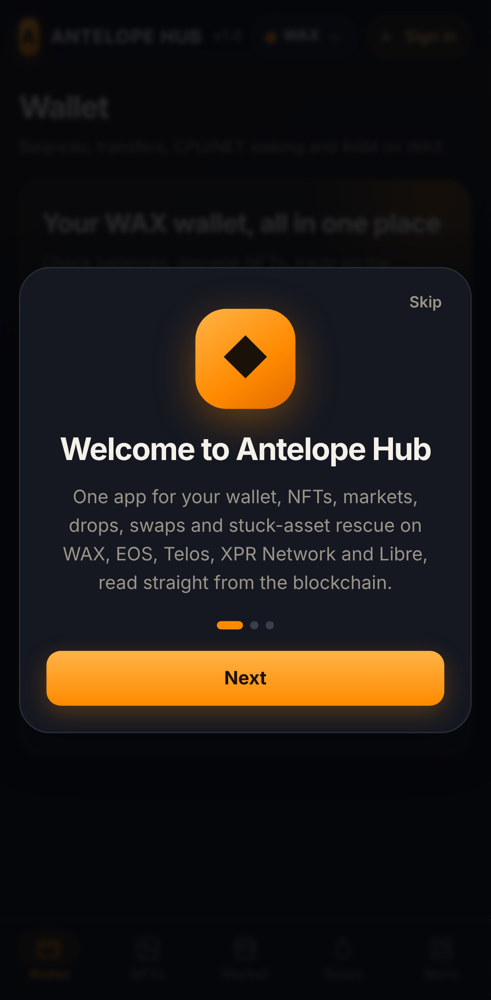
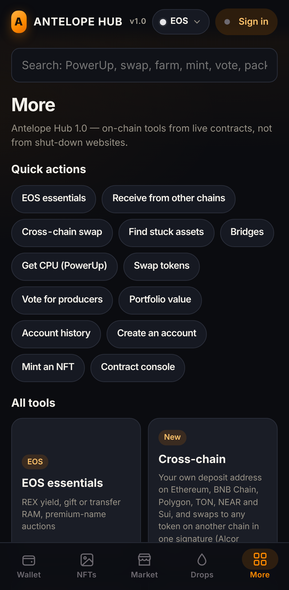
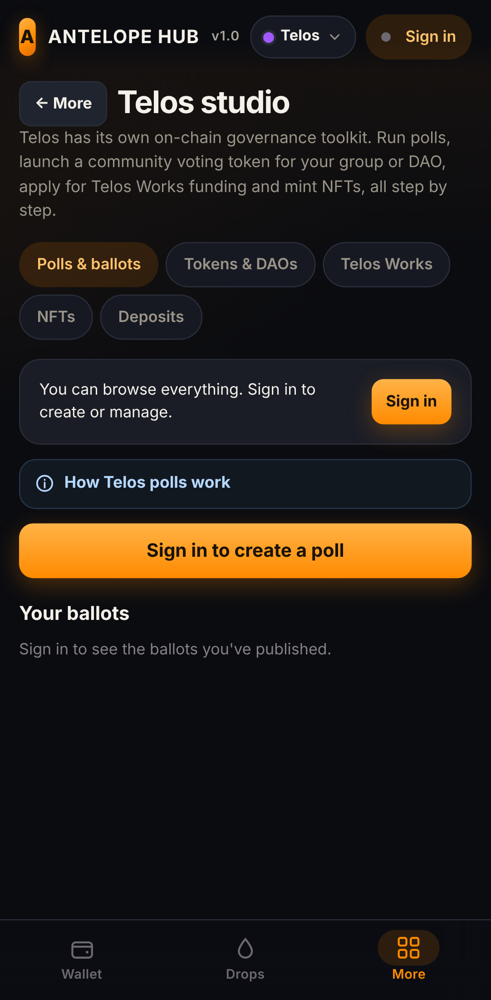

# Antelope Hub user guide

For Antelope Hub 1.0. This guide is for new users and for anyone coming from WAX Hub. It covers installing, signing in, every screen, and a full walkthrough of the **Contract console**, the part of the app for using any smart contract directly.

**Contents**
1. [Before you start](#1-before-you-start)
2. [Install](#2-install)
3. [Sign in](#3-sign-in)
4. [Find your way around](#4-find-your-way-around)
5. [The Contract console](#5-the-contract-console)
6. [Rescue & recover](#6-rescue--recover)
7. [Bridges and cross-chain](#7-bridges-and-cross-chain)
8. [Network notes](#8-network-notes)
9. [Resources: CPU, NET and RAM](#9-resources-cpu-net-and-ram)
10. [Errors and what they mean](#10-errors-and-what-they-mean)
11. [Safety checklist](#11-safety-checklist)
12. [Coming from WAX Hub](#12-coming-from-wax-hub)
13. [Glossary](#13-glossary)

---

## 1. Before you start

- **Antelope Hub never holds your keys.** It builds transactions and your wallet signs them. If you reject a request in your wallet, nothing is sent.
- **Every transaction is shown to you first**, in plain English, on a confirmation sheet. Read it.
- **Blockchain transactions can't be undone.** A wrong address, amount or memo is usually permanent. When something is new to you, try a small amount first.
- **Nobody from Antelope Hub will ever message you.** Anyone asking for your private key, your seed words, or for you to "sign this to fix your account" is trying to steal it.

## 2. Install

Download only from the repository's [Releases page](../../../releases/latest). Each release has a `SHA256SUMS.txt`. To check your file is genuine:

```bash
sha256sum -c SHA256SUMS.txt --ignore-missing     # Linux / macOS
```

| Platform | File | How |
|---|---|---|
| Android 6.0+ | `antelope-hub-<version>.apk` | Open the file on your phone. If Android asks, allow installs from your browser or file manager. It updates WAX Hub in place. |
| Ubuntu, Debian, Mint, Pop!_OS | `antelope-hub-<version>-amd64.deb` | `sudo apt install ./antelope-hub-<version>-amd64.deb`, then open **Antelope Hub** from your apps menu. |
| Any Linux | `antelope-hub-<version>-x86_64.AppImage` | `chmod +x antelope-hub-*.AppImage && ./antelope-hub-*.AppImage` |

Linux notes:
- **Ubuntu 24.04 and newer:** use the `.deb`. Ubuntu blocks the sandbox that Electron AppImages need, so the AppImage may not start there.
- **Ubuntu 22.04 AppImage:** you may need `sudo apt install libfuse2`.
- If you installed a pre-release test build (4.x) of the `.deb`, remove it first: `sudo apt remove antelope-hub`.

## 3. Sign in

| Wallet | Networks | Notes |
|---|---|---|
| **Anchor** (desktop or mobile) | All: WAX, EOS, Telos, XPR Network, Libre, Jungle 4 | Import your account's private key into Anchor once; Antelope Hub then asks Anchor to sign. |
| **My Cloud Wallet** | WAX | Sign in with email, Google, Apple and others. Accounts end in `.wam`. |
| **WebAuth** | XPR Network | XPR Network's own wallet app. Approve with your fingerprint or face; on a computer, scan the QR code with WebAuth on your phone. |

**First pick your network.** Tap the network chip at the top of the screen (WAX, EOS, Telos, XPR, Libre, Jungle 4). The app reloads for that chain, and your choice is remembered.

**No account yet?** Go to **More → New account**. It explains the free route for your network:
- **WAX:** My Cloud Wallet.
- **Telos:** Telos Wallet.
- **XPR Network:** WebAuth.
- **Libre:** the Bitcoin Libre app.
- **Jungle 4:** the testnet faucet.

You can also create an account from one you already have. The app makes the keys on your device and never stores them; write the private key down before you continue.

> **XPR Network accounts made in WebAuth:** choose **WebAuth** when you sign in (it appears on XPR Network). On your phone it opens the WebAuth app; on a computer, scan the code with WebAuth or use the browser option. Anchor works too, if you import your WebAuth key into it.

## 4. Find your way around

<p>
  
  
  
</p>

The bottom bar holds **Wallet**, **NFTs**, **Market**, **Drops** and **More**. Tabs only appear where the network supports them; for example, Libre has no NFTs tab.

### Wallet
Balances with USD values, plus send and receive. You'll also find staking (CPU/NET), RAM and resource health. On EOS there's a 1:1 **EOS ⇄ A** (Vaulta) converter.

### More → tools
| Tool | What it does |
|---|---|
| **‹Network› essentials** | That network's own features: REX, RAM gifting and name auctions (EOS/Jungle 4); voting rewards (WAX); Telos Decide votes and REX (Telos); XPR staking and Metal X (XPR); Libre staking and DAO |
| **Telos studio** (Telos) | Polls and ballots, community voting tokens, Telos Works funding proposals, fee deposits |
| **XPR DeFi** (XPR) | LOAN lending and borrowing, SimpleDEX, Metal X trading (limit and market orders), oracle prices, WebAuth profiles and KYC |
| **Cross-chain** (WAX, EOS, Telos, XPR) | Your own deposit address on Ethereum, BNB Chain, Polygon, TON, NEAR and Sui; swaps to another token on another chain; transfer activity |
| **Bridges** | Every live and old bridge on the network, with its status and actions |
| **New account** | Guided account creation |
| **Rescue & recover** | Finds value stuck in contracts and gets it back |
| **Contract console** | Use any contract directly (see section 5) |
| **Creator studio** | NFT collections, schemas, templates, minting, drops and blends (AtomicAssets) |
| **Packs** (WAX) | Your unopened AtomicHub, NeftyBlocks and NFTHive packs, with an Open button, plus reveals waiting to be claimed |
| **Swap** (WAX, EOS, Telos, XPR) | Best price for any token across Alcor's pools and order books, with the minimum you'll receive shown before you sign |
| **DEX & swaps, WAXDAO** | Where the network has them |
| **Chain tools** | Vote for producers, PowerUp, account and resources, history, portfolio, QR codes, watch list, claim links |

Search on the More screen filters every tool and quick action.

## 5. The Contract console

**More → Contract console** lets you call any action on any contract and read any table, even when the project's website is gone. It's the most powerful tool in the app. With care, it's also safe.

### 5.1 Five ideas you need

| Term | Plain meaning | Example |
|---|---|---|
| **Contract** | The account where a dApp's code lives | `atomicmarket`, `telos.decide`, `lending.loan` |
| **Action** | A function of that contract, the "button" a website would press for you | `withdraw`, `claim`, `cancelsale` |
| **ABI** | The contract's published list of actions, tables and field types. The console builds its forms from it. | – |
| **Table** | Data the contract stores. You read it to find IDs and balances. | `sales`, `balances`, `shares` |
| **Scope** | A "folder" inside a table: often the contract itself, sometimes your account | scope `telos.decide`, or scope `youraccount` |

### 5.2 Quick start: a ready-made task
1. Open **Contract console**. Under **Common tasks** you'll see ready-made jobs for the current network: send tokens or NFTs, burn an NFT, cancel a claim link, withdraw from AtomicMarket, claim a refund, Telos voting tasks, approve a multisig proposal, and more.
2. Tap one. The contract loads and the form opens with your account already filled in.
3. Fill the empty fields, using the hint under each one.
4. Tap **Review**, read the confirmation sheet, then **Approve in wallet**.

### 5.3 Walkthrough: any action, from scratch
1. **Load the contract.** Type its account name, such as `atomicmarket`, and tap **Load**. The box suggests known contracts as you type, **Popular contracts** lists them all, and **Recent** remembers the last eight you used.
2. **Pick the action.** The **Actions** tab lists every action. Use the filter box (type `claim`, `withdraw`, `cancel`). Highlighted actions usually return funds or NFTs to you. If the contract has written a description for an action, it shows under **What the contract says this action does**.
3. **Fill the form.** Each field shows its type and a plain-English hint (see 5.5). Fields like `owner`, `from`, `account`, `claimer` and `voter` are filled in with your account for you.
4. **Review.** The confirmation sheet shows `contract::action as you@active` and the exact data that will be sent.
5. **Approve in your wallet.** You'll see a toast with the transaction ID when it's done, and you can open it in the block explorer.

### 5.4 Walkthrough: find what to fill in, using tables
Most actions need an ID, such as a sale ID, deposit ID, ballot name or farm name. The contract's own tables hold them.

1. Load the contract and open the **Tables** tab. Pick a table.
2. Set **Scope** and **Bounds**, then tap **Fetch rows**. Two shortcuts:
   - **Scope = me** looks in your account's folder. Many contracts keep per-user data there.
   - **Key = me** jumps to the row whose key is your account name, in the contract's own folder.
3. Read the rows (shown as JSON), copy the ID you need, and go back to **Actions**.

Real examples (all checked on mainnet):

| Goal | Contract | Table | How to fetch | Then run |
|---|---|---|---|---|
| Unused Telos Decide fee deposit | `telos.decide` | `accounts` | **Scope = me** | `withdraw(voter, quantity)` |
| Your LOAN supply on XPR | `lending.loan` | `shares` | **Key = me** | `redeem(...)`, or use XPR DeFi |
| A stuck SimpleDEX deposit on XPR | `simpledex` | `deposits` | **Scope = me**; note the `id` | `withdrawdep(account, depositId)` |
| Your Metal X exchange balance | `dex` | `balances` | **Key = me** | `withdrawall(account)` |
| An open Telos ballot | `telos.decide` | `ballots` | default scope, **Newest first** | `castvote(voter, ballot_name, options)` |

More table options:
- **Lower / Upper bound** fetches a range of keys.
- **Index** (1 = the primary key) and **Key type** let you search a secondary index, such as "all rows by owner".
- **Limit** sets how many rows to fetch (up to 500), and **Newest first** reverses the order.

### 5.5 Field formats: the cheat sheet
| Field type | Write it like | Notes |
|---|---|---|
| `name` | `youraccount` | 1–12 characters: `a–z`, `1–5`, `.`; lowercase only |
| `asset` | `1.00000000 WAX`, `10.0000 TLOS`, `5.000000 USDC` | **All** of the token's decimals, a space, then the symbol. Wrong decimals are the most common error. |
| `symbol` | `8,WAX` | decimals, comma, code |
| `symbol_code` | `WAX` | code only |
| `extended_asset` | quantity `1.0000 XPR` + contract `eosio.token` | two boxes |
| integers (`uint64`, `int32`…) | `123456` | whole numbers; long IDs are fine |
| `float64` | `1.5` | |
| `bool` | tick box | |
| `time_point_sec` | `2026-12-31T23:59:59` | UTC |
| `checksum256` | 64 hex characters | e.g. a transaction hash |
| `public_key` | `PUB_K1_…` or `EOS…` | |
| `bytes` | hex | |
| lists (`type[]`) | one item per line, or **+ Add item** | e.g. NFT asset IDs |
| optional (`type?`, `type$`) | tick the box to include it | leave unticked to send "nothing" |
| variants | pick the type from the drop-down, then fill it | |

Where do the decimals come from? Your wallet shows them. In the console, the token contract's `stat` table (scope = the symbol, e.g. `WAX`) shows the supply with every decimal.

### 5.6 JSON mode, for advanced users
Switch the form to **JSON** to see or paste the exact data. It's handy for copying from a project's documentation. Switching from the form to JSON converts what you've typed. If the JSON doesn't parse, the app tells you before anything is sent.

### 5.7 Memos: the rule that loses people money
Many contracts read the **memo** of a token transfer as instructions. Get it exactly right:

| Where you send | Memo | Network |
|---|---|---|
| Metal X `dex` (deposit) | **empty**; any other memo loses the tokens, so Antelope Hub blocks it | XPR |
| `lending.loan` | `mint` to supply, `repay` to repay | XPR |
| `simpledex` | `swap:POOL:MIN_OUT:true/false`; XPR DeFi builds this for you | XPR |
| `eosio.evm` | your `0x…` EVM address | Telos |
| `eosio.evmin` | your `0x…` EVM address | EOS |
| `bridge.alcor` | built by Bridges / Cross-chain; don't hand-type it | WAX, EOS, Telos, XPR |
| `telos.decide` | any memo except `skip` (it becomes a fee deposit) | Telos |
| an exchange | the deposit memo/tag the exchange gives you | any |

If a screen in the app does the job (Bridges, Cross-chain, XPR DeFi, Telos studio), use it rather than the console: it writes the memo for you and checks limits.

### 5.8 High-risk actions
Actions that can hand control of your account to someone else, or replace its code, are flagged in red. On the system contract these are `updateauth`, `deleteauth`, `linkauth`, `unlinkauth`, `setcode` and `setabi`. You must type your account name to confirm them. **Never run one because someone asked you to in a chat, DM or "support" ticket.** That's how accounts get stolen.

### 5.9 Multisig (`eosio.msig`)
The **Approve a multisig proposal** task approves a proposal someone else created. To find it, load `eosio.msig`, open the **Tables** tab, pick `proposal` and set **Scope** to the proposer's account. Read the proposal's actions before you approve.

### 5.10 Tips from experience
- **Try Rescue & recover first.** It finds most stuck items and fills in the console forms for you.
- **Read before writing.** Check a table to confirm a balance or ID exists before you send an action that needs it.
- **Small first.** Do a small transfer before a large one, especially across bridges.
- **"Untested" actions** in Rescue are built from the ABI but haven't been seen working on mainnet recently. Read the confirmation carefully.
- **Developers:** `tests/dryrun/` in the repository can run any transaction against a chain's current state without signing or broadcasting, using `compute_transaction`. That's how this release was tested.

## 6. Rescue & recover
**More → Rescue & recover** scans dozens of contracts for anything still held for an account:
- deposits left in markets and drops
- unclaimed rewards: voting, staking, LOAN, farms
- refunds after unstaking
- matured REX
- open orders: Alcor, Metal X
- unfinished deposits: SimpleDEX
- NFTs hidden in the Wombat Dungeon (Dungeon Master), on WAX and EOS: unstake them, then claim them back after 24 hours
- claim links
- bridge transfers waiting to be claimed
- tokens left from old bridges
- Telos Decide and Works deposits

- You can scan **any** account, but only its owner can recover items.
- **Recover the simple ones in one go** batches up to ten simple items into one transaction.
- If a place couldn't be checked (a busy public node), scan again in a minute.
- **What is and isn't checked** at the bottom lists every contract covered, with tips for the rest.

## 7. Bridges and cross-chain
- **Bridges** lists every bridge on the network with live status (Active, Quiet, Inactive), the wrapped tokens you hold from it, and its actions.
- **WAX → Ethereum:** on the WAX Bridge card, **Send WAX to Ethereum** sends native WAX to an Ethereum address you control, where it arrives as WAXP (ERC-20). Minimum 10 WAX. Don't send to an exchange deposit address unless the exchange says it accepts bridge deposits.
- **A → EOS EVM:** on the EOS EVM card, **Send A (gas token) to EOS EVM** sends A (or EOS, converted 1:1 in the same transaction) to any EVM address. There's a 0.1 A entry fee.
- **Address check:** an Ethereum/EVM address written in mixed case must match its checksum, so a mistyped character is caught before you sign.
- **Cross-chain → Receive** gives you a personal deposit address on Ethereum, BNB Chain, Polygon, TON, NEAR and Sui. It pays into your account, and you can send to it straight from an exchange. The EVM address is recomputed on your device and only shown if it matches.
- **Cross-chain → Swap** sends any token you hold and delivers another token on another chain, in one signature. You see the expected amount, the minimum and the price impact.
- **Courier fee:** for Ethereum, BNB Chain and Polygon, a small fee pays for delivery. Without it, the recipient has to release the tokens on that chain themselves.
- **Minimums matter:** below a bridge's minimum, a transfer is refused or waits. The app shows the minimum.
- **Only send on the networks listed.** Arbitrum, Base, Tron and others aren't supported, and funds sent there may be lost.

## 8. Network notes
- **WAX:** My Cloud Wallet or Anchor. Claim voting rewards once every 24 hours if you vote.
- **EOS (Vaulta):** EOS was rebranded to Vaulta (token **A**). Staking (REX) runs in **A**, and the app converts EOS for you. A stake stays locked until you tap **Start unstaking**; 21 days later you can sell it and withdraw. A new account needs RAM (4 KB), and the app includes it. New accounts need CPU: use **PowerUp**.
- **Telos:**
  - Voting uses **VOTE**, which comes from staked TLOS. Register once (the app does this on your first vote).
  - Ballot fees (10 TLOS) and token fees (20 TLOS) come from your Decide deposit. Withdraw any leftovers in **Telos studio → Deposits**.
- **XPR Network:**
  - No transaction fees.
  - Vote for **exactly 4** producers, or you get no staking rewards. The vote tool enforces this.
  - Claim rewards with **Claim XPR staking rewards**.
  - Never send to Metal X `dex` with a memo.
- **Libre:** staking, the DAO, and Bitcoin/USDT bridges. Create accounts in the Bitcoin Libre app.
- **Jungle 4:** a testnet with free tokens from its faucet. Use it to practise. REX there needs test **A** tokens, which the faucet doesn't give out.

## 9. Resources: CPU, NET and RAM
On WAX, EOS, Telos and Jungle 4, transactions use **CPU** and **NET** (bandwidth), and stored data uses **RAM**.
- **Not enough CPU/NET:** rent some for 24 hours with **More → Chain tools → PowerUp**, or stake tokens to CPU/NET in the Wallet.
- **EOS account with only A (everything converted, stake included)?** You can still move NFTs and tokens. The **Vaulta ($A)** card in the Wallet shows your CPU, NET and RAM, and **Pay for resources with A when I run out** (on by default) adds a small 24-hour PowerUp paid in A, plus 1 KB of RAM if needed, to the transaction you sign. It usually costs well under 0.01 A. Your wallet lists the extra actions before you approve, and you can also rent on its own with **Rent CPU/NET for 24h with A now**.
- **Not enough RAM:** buy a little in the Wallet. RAM is needed when a contract stores something new for you, such as a first token balance.
- On **XPR Network and Libre**, resources are free.

## 10. Errors and what they mean
| Message contains | Meaning | Fix |
|---|---|---|
| `overdrawn balance` | You don't hold that much | Lower the amount; check the token contract |
| `symbol precision mismatch` or `asset` parse errors | Wrong number of decimals | Use all of the token's decimals: `1.0000 TLOS`, `1.00000000 WAX` |
| `missing authority of …` | Signed by the wrong account or permission | Sign in as that account, or fix the account field |
| `billed CPU time` / `tx_cpu_usage_exceeded` | Not enough CPU | PowerUp or stake (section 9) |
| `net usage` | Not enough NET | PowerUp or stake |
| `insufficient ram` / `ram_usage_exceeded` | Not enough RAM | Buy a little RAM |
| `unknown key` / `no balance object found` | A row doesn't exist (no balance, nothing to claim) | Check the table first |
| `Table … is not specified in the ABI` | Wrong table name for this contract | Pick it from the Tables list |
| `assertion failure: …` | The contract refused, for the reason written after the colon | Read the reason, e.g. "below the route minimum" |
| `expired transaction` | It took too long to approve | Try again and approve within two minutes |
| `Request cancelled` | You rejected it in the wallet | Nothing was sent |

## 11. Safety checklist
- [ ] Downloaded from the official Releases page, and the checksum matches
- [ ] Network chip shows the right network
- [ ] Confirmation sheet: right contract, action, account, amount and memo
- [ ] Recipient address double-checked (EVM addresses: check the first and last 4 characters)
- [ ] New bridge or route? Small test first
- [ ] Red high-risk action? Only if *you* decided to, never because someone asked
- [ ] Private keys written down offline, never typed into a website or chat

## 12. Coming from WAX Hub
- **Same app, new name.** On Android, Antelope Hub installs over WAX Hub as an update. It uses the same app id and signing key, so your settings carry over.
- **WAX is still the default network.** Switch networks with the chip at the top.
- **Everything WAX Hub did is still here:** wallet, NFTs, market, drops, Creator studio, Rescue and the Contract console. They now work on more networks.
- **New:** Bridges, Cross-chain, Telos studio, XPR DeFi, guided New account, more Rescue checks, and on-device QR codes.

## 13. Glossary
- **A (Vaulta):** EOS's new token; converts 1:1 with EOS.
- **ABI:** a contract's published description of its actions and tables.
- **Action:** one function of a contract.
- **Anchor:** an Antelope wallet that works on every network.
- **Collateral factor:** in LOAN, how much of a supplied token's value counts towards borrowing.
- **Courier fee:** pays someone to deliver bridged tokens on an EVM chain.
- **Health factor:** LOAN collateral value ÷ debt. Below 1.0 your position can be liquidated; the app keeps you above 1.25.
- **Memo:** a text note on a transfer; some contracts treat it as instructions.
- **Permission:** `active` (everyday) or `owner` (recovery). Antelope Hub signs with `active`.
- **PowerUp:** rent CPU and NET for 24 hours.
- **REX:** the resource exchange; lend tokens to earn a share of fees.
- **Scope:** a folder inside a contract table.
- **VOTE:** Telos's voting token, from staked TLOS.

---

*Antelope Hub is free and open source (MIT). Found a problem? Open an issue on the repository. Never post private keys in an issue.*
